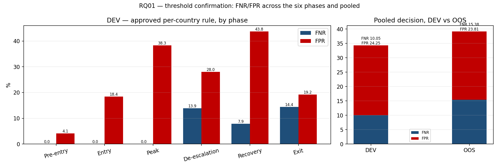
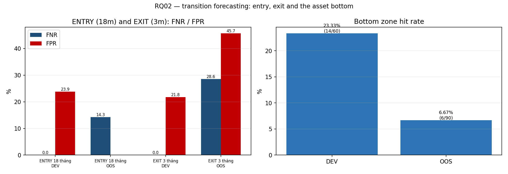
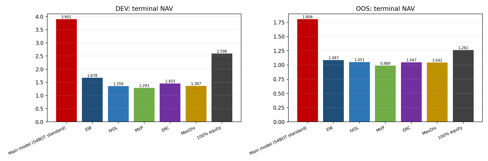

# RQ01–RQ03 research code — DEV / OOS evidence

Reproducible code and results for a three-stage decision chain over seven euro-area countries:
confirm the current stress state (RQ01) → forecast state transitions and the asset bottom (RQ02)
→ allocate the portfolio by state (RQ03).

```
RAW_CODE/     run_canonical.py, canonical_*.py, rev363/, research_adapters/, rq02_source/, rq03_standard/
THRESHOLD/    selected RQ01, RQ02 and RQ03 configurations (JSON)
scripts/      build_final_results.py (this file's driver), build_rq03_standard.py
results/      CSV tables and PNG figures for DEV and OOS
```

## Quick start

```bash
pip install -r requirements.txt
python RAW_CODE/run_canonical.py --dataset-root <ASSET03> --out <out> --mode dev
python RAW_CODE/run_canonical.py --dataset-root <ASSET03> --out <out> --mode oos \
    --oos-authorization <DEC-015 owner token>
python scripts/build_final_results.py --project <project> --repo . \
    --ledger-dir <rq03 standard ledgers> --dataset <ASSET03>
```

## RQ01 — stress-state confirmation, six phases, individual and pool votes

Selected rule, per country: `((Ps_XGB_M01 >= t_country) OR pkt_joint_CLIFS_VIX) AND NOT pkt_joint_DFC_GFC`.
The DEV block is rebuilt directly from the per-record P4 dump merged with the packet features,
and it reproduces the registered confusion exactly: **TP/FN/FP/TN = 376/42/194/606**.

| period | TP | FN | FP | TN | FNR | FPR | source |
|---|---|---|---|---|---|---|---|
| DEV | 376 | 42 | 194 | 606 | 10.05 | 24.25 | reproduced from P4 dump + packet features |
| OOS | 77 | 14 | 5 | 16 | 15.38 | 23.81 | owner-selected register (OOS XGB tape not shipped) |

Per phase on DEV:

| phase_label | n | TP | FN | FP | TN | FNR | FPR |
|---|---|---|---|---|---|---|---|
| Pre-entry | 148 | 1 | 0 | 6 | 141 | 0.00 | 4.08 |
| Entry | 44 | 6 | 0 | 7 | 31 | 0.00 | 18.42 |
| Peak | 62 | 15 | 0 | 18 | 29 | 0.00 | 38.30 |
| De-escalation | 86 | 31 | 5 | 14 | 36 | 13.89 | 28.00 |
| Recovery | 429 | 210 | 18 | 88 | 113 | 7.89 | 43.78 |
| Exit | 449 | 113 | 19 | 61 | 256 | 14.39 | 19.24 |
| All phases | 1218 | 376 | 42 | 194 | 606 | 10.05 | 24.25 |



Reading: the rule is conservative in the calm phases (Pre-entry FPR 4.1%, Peak FNR 0%) and pays for it
in the recovery phase, where FPR rises to 43.8% while FNR stays at 7.9% — the model rarely misses a
stress month but over-fires while the economy is already healing. OOS keeps the same balance
(FNR 15.38%, FPR 23.81%) but the per-phase split cannot be rebuilt because the OOS XGBoost score tape
is not part of the shipped package.

## RQ02 — entry (H6, 18 months), exit (3 months) and the asset bottom

| task | period | threshold | n | TP | FN | FP | TN | FNR | FPR |
|---|---|---|---|---|---|---|---|---|---|
| ENTRY 18 tháng — hồi quy logistic L2 mạnh | DEV | 0.11 | 653 | 108 | 0 | 130.00 | 415.00 | 0.00 | 23.85 |
| ENTRY 18 tháng — hồi quy logistic L2 mạnh | OOS | 0.11 | 14 | 12 | 2 | — | — | 14.29 | — |
| EXIT 3 tháng | DEV | 0.03 | 418 | 18 | 0 | 87.00 | 313.00 | 0.00 | 21.75 |
| EXIT 3 tháng | OOS | 0.03 | 91 | 15 | 6 | 32.00 | 38.00 | 28.57 | 45.71 |

| period | n_hit | n_issued_matured | hit_rate | forecast_coverage |
|---|---|---|---|---|
| DEV | 14 | 60 | 23.33 | 70.59 |
| OOS | 6 | 90 | 6.67 | 94.74 |



Reading: entry has zero missed onsets in DEV at 23.85% false alarms; exit degrades the most out of sample
(FNR 0.00% → 28.57%, FPR 21.75% → 45.71%). The bottom zone is the weakest block — 23.33% of matured
forecasts hit in DEV and 6.67% in OOS, with a negative median lead time (the model fires late).
The OOS entry FPR is undefined because all 14 scorable observations are positives.

## RQ03 — main model NAV versus five benchmarks and 100% equity

Standard: `W16_S4BOT_Z2` + ENTRY H12 + EXIT-3m on the RQ03 phase clock (EXIT threshold 0.027174, 10 bp one-way).

| period | weeks | POLICY | EW | IVOL | MVP | ERC | MaxDiv | EQUITY100 |
|---|---|---|---|---|---|---|---|---|
| DEV | 781 | 3.90 | 1.68 | 1.36 | 1.29 | 1.45 | 1.37 | 2.60 |
| OOS | 260 | 1.81 | 1.09 | 1.05 | 0.99 | 1.05 | 1.04 | 1.26 |

| period | weeks_normal | weeks_to_short | weeks_to_bottom | weeks_to_exit |
|---|---|---|---|---|
| DEV | 52 | 42 | 596 | 91 |
| OOS | 30 | 13 | 187 | 30 |




Reading: the main model ends DEV at 3.9015 against 1.2934–1.6784 for the five benchmarks and 2.5960 for
100% equity, and OOS at 1.8059 against 0.9892–1.0867 and 1.2611; the full-sample path compounds to
5.6981. The cost is tail risk: maximum drawdown 32.84% and weekly ES95 4.52% in DEV are the highest in
the group, so the excess return is paid for with a permanently high equity share rather than with timing
of de-risking. Shading marks the four lifecycle stages; the "last short to bottom" stage dominates by
design because the state machine stays frozen there for most of the sample.

## Audit — what reproduces and what does not

| Block | Claim | Evidence | Status |
|---|---|---|---|
| RQ01 DEV | 42 FN / 194 FP, FNR 10.05% / FPR 24.25% | P4 dump + packet features + per-country thresholds | **Reproduced exactly** |
| RQ01 DEV per phase | six-phase split | same merge, phase tape from the canonical run | **Reproduced** |
| RQ01 OOS | 14 FN / 5 FP, FNR 15.38% / FPR 23.81% | owner-selected register | Registered, not rebuilt (no OOS XGB tape) |
| RQ02 | entry 0.111821 → 0.00/23.85 DEV, 14.29/— OOS | `THRESHOLD/RQ02` and the selected metrics table | Registered, not rebuilt (no per-record label tape) |
| RQ02 alternates | 0.191936 → 0.00/12.48 · 0.244947 → 0.00/3.67 | shipped entry-metrics registry | **Reproducible** |
| RQ03 | 3.9015 / 1.8059 / 5.6981 | S4BOT standard builder + ledgers | **Reproduced exactly** |

RQ02 threshold audit:

| variant | DEV_FNR | DEV_FPR | OOS_FNR | OOS_FPR | status |
|---|---|---|---|---|---|
| owner-selected M11 / H6 = 0.111821 | 0.00 | 23.85 | 14.29 | — | SELECTED — tape not shipped |
| reproducible LOGISTIC_L2_STRONG H6 = 0.191936 | 0.00 | 12.48 | 35.71 | — | REPRODUCIBLE from shipped registry |
| reproducible LOGISTIC H6 = 0.244947 | 0.00 | 3.67 | 42.86 | — | REPRODUCIBLE from shipped registry |

The owner-selected operating point (0.111821) is kept in `THRESHOLD/RQ02`; the packaged registry offers
0.191936 and 0.244947 as the reproducible alternatives. They are different operating points on the same
score, not competing models, and they are reported side by side rather than substituted.

## Data and dependencies

The locked ASSET03 dataset (`Euro_Area_Dataset_Mentor_Ready`) is not shipped; pass its root at run time.
No threshold is inferred at run time — every selected value lives in `THRESHOLD/`.
