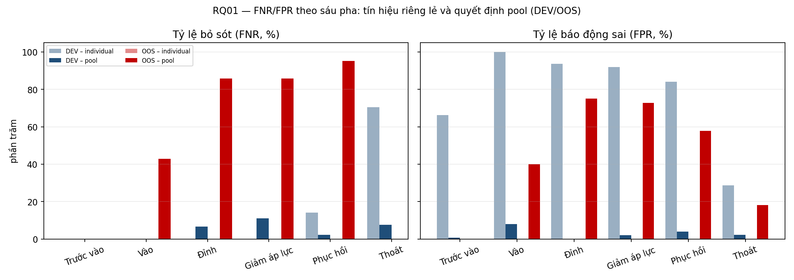
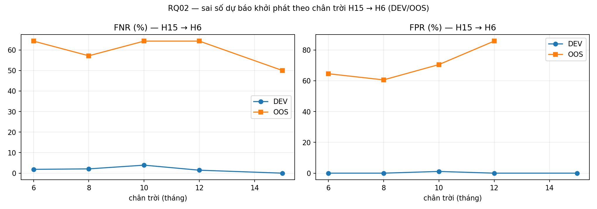
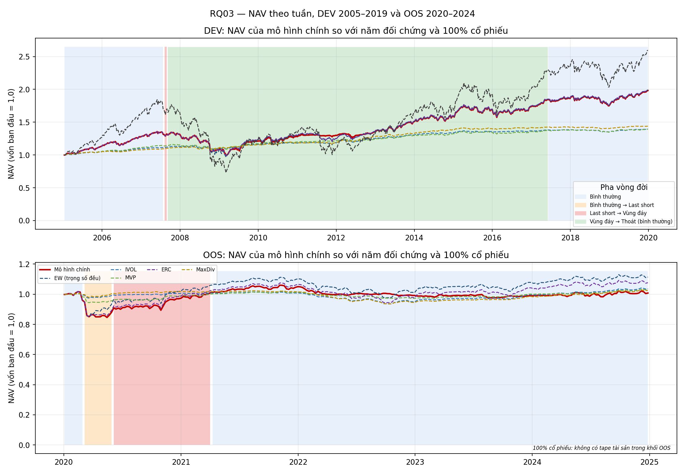
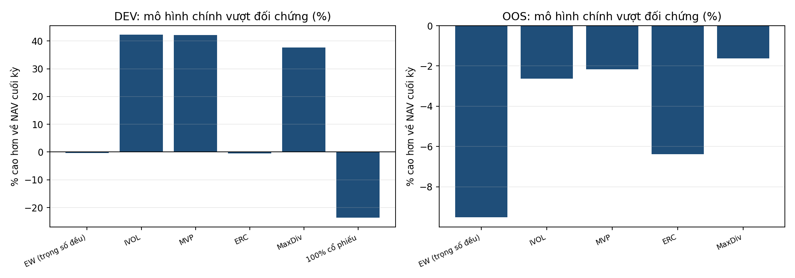

# RQ01–RQ03 canonical research code — DEV / OOS

Mã nguồn hợp nhất cho chuỗi quyết định ba câu hỏi nghiên cứu (xác nhận trạng thái →
dự báo chuyển trạng thái → phân bổ danh mục) trên bảy quốc gia khu vực đồng euro.

Repo gồm hai thư mục thực thi và một thư mục kết quả tái lập được:

```
RAW_CODE/     # entrypoint run_canonical.py + rev363/ + research_adapters/ + rq02_source/
THRESHOLD/    # RQ01, RQ02, RQ03 selected configurations (JSON)
scripts/      # build_results.py – sinh toàn bộ bảng và hình trong results/
results/      # CSV + PNG của lần chạy DEV/OOS gần nhất
```

## Chạy lại

```bash
pip install -r requirements.txt
python RAW_CODE/run_canonical.py --dataset-root <ASSET03 locked dataset> --out <out dir> --mode dev
python RAW_CODE/run_canonical.py --dataset-root <ASSET03 locked dataset> --out <out dir> --mode oos     --oos-authorization <DEC-015 owner token>
python scripts/build_results.py --run <out dir> --out results
```

`--mode dev` chỉ mở 2005-07..2019-12. `--mode oos` là lượt một lần: kiểm tra hash của ba
freeze DEV trước khi mở 2020-01..2024-12 và **fail-closed** nếu thiếu token chủ sở hữu.

## RQ01 — FNR/FPR theo sáu pha, tín hiệu riêng lẻ và quyết định pool

Sáu pha: trước vào, vào, đỉnh, giảm áp lực, phục hồi, thoát. "Individual" là phiếu của
tầng chỉ báo riêng lẻ; "pool" là quyết định sau khi hợp phiếu individual/joint.

| period | phase_vi | n_pool | pool_FNR | pool_FPR | n_ind | ind_FNR | ind_FPR |
|---|---|---|---|---|---|---|---|
| DEV | Trước vào | 148 | 0.00 | 0.68 | 78 | 0.00 | 66.23 |
| DEV | Vào | 44 | 0.00 | 7.89 | 44 | 0.00 | 100.00 |
| DEV | Đỉnh | 62 | 6.67 | 0.00 | 62 | 0.00 | 93.62 |
| DEV | Giảm áp lực | 86 | 11.11 | 2.00 | 86 | 0.00 | 92.00 |
| DEV | Phục hồi | 429 | 2.19 | 3.98 | 429 | 14.04 | 84.08 |
| DEV | Thoát | 449 | 7.58 | 2.21 | 449 | 70.45 | 28.71 |
| DEV | Toàn bộ | 1218 | 4.78 | 2.50 | 1148 | 29.90 | 60.14 |
| OOS | Trước vào | 12 | — | 0.00 | 0 | — | — |
| OOS | Vào | 31 | 42.86 | 40.00 | 0 | — | — |
| OOS | Đỉnh | 22 | 85.71 | 75.00 | 0 | — | — |
| OOS | Giảm áp lực | 25 | 85.71 | 72.73 | 0 | — | — |
| OOS | Phục hồi | 286 | 95.24 | 57.79 | 0 | — | — |
| OOS | Thoát | 44 | — | 18.18 | 0 | — | — |
| OOS | Toàn bộ | 420 | 80.22 | 50.76 | 0 | — | — |

Nguồn: `results/rq01_fnr_fpr_phase_pool.csv`; bảng cơ chế pool (IND_ONLY / JOINT_ONLY /
IND_AND_JOINT …) ở `results/rq01_pool_operators_dev.csv`.



## RQ02 — H15 → last short, và vùng đáy

| period | horizon | n | events | auc | FNR | FPR |
|---|---|---|---|---|---|---|
| DEV | H6 | 716 | 108 | 1.00 | 1.85 | 0.00 |
| DEV | H8 | 674 | 144 | 1.00 | 2.08 | 0.00 |
| DEV | H10 | 632 | 180 | 1.00 | 3.89 | 1.11 |
| DEV | H12 | 595 | 209 | 1.00 | 1.44 | 0.00 |
| DEV | H15 | 546 | 230 | 1.00 | 0.00 | 0.00 |
| OOS | H6 | 203 | 14 | 0.36 | 64.29 | 64.55 |
| OOS | H8 | 161 | 14 | 0.38 | 57.14 | 60.54 |
| OOS | H10 | 119 | 14 | 0.24 | 64.29 | 70.48 |
| OOS | H12 | 77 | 14 | 0.12 | 64.29 | 85.71 |
| OOS | H15 | 14 | 14 | — | 50.00 | — |

Tín hiệu "last short" (S5) — có mặt của một mốc last short so với nhãn căng thẳng:

| period | TP | FN | FP | TN | FNR | FPR | n |
|---|---|---|---|---|---|---|---|
| DEV | 418 | 0 | 499 | 343 | 0.00 | 59.26 | 1260 |
| OOS | 65 | 26 | 245 | 84 | 28.57 | 74.47 | 420 |

Vùng đáy:

| period | HIT | MISS | hit_rate | status |
|---|---|---|---|---|
| DEV | 15.00 | 21.00 | 41.67 | SCORED |
| OOS | — | — | — | OOS_BOTTOM_SEALED_NOT_SCORED |

`OOS_BOTTOM_SEALED_NOT_SCORED`: khối OOS của vùng đáy bị niêm phong, không chấm điểm —
hệ thống ghi trạng thái thay vì suy ra số.



## RQ03 — NAV của mô hình chính so với năm đối chứng và 100% cổ phiếu

| period | n_weeks | POLICY | EW | IVOL | MVP | ERC | MaxDiv | EQUITY100 |
|---|---|---|---|---|---|---|---|---|
| DEV | 781 | 1.98 | 1.99 | 1.39 | 1.39 | 1.99 | 1.44 | 2.60 |
| OOS | 261 | 1.01 | 1.11 | 1.04 | 1.03 | 1.08 | 1.02 | — |

Số tuần theo từng pha vòng đời (bình thường → last short → vùng đáy → thoát):

| period | weeks_normal | weeks_to_short | weeks_to_bottom | weeks_to_exit |
|---|---|---|---|---|
| DEV | 267 | 1 | 4 | 509 |
| OOS | 204 | 13 | 44 | 0 |





### Đọc hình NAV
* Nền xanh nhạt: bình thường; cam: bình thường → last short; đỏ: last short → vùng đáy;
  xanh lá: vùng đáy → thoát.
* Nét liền đỏ là mô hình chính; nét đứt là năm đối chứng; nét xám là 100% cổ phiếu
  (chỉ có ở DEV vì khối OOS không kèm tape tài sản).
* Khối OOS không có mốc đáy nên hai pha "last short → vùng đáy" và "vùng đáy → thoát"
  không hiển thị được ở panel dưới.

## Điều cần biết trước khi trích dẫn số trong repo này

Mã trong `RAW_CODE/` là **thế hệ REV363** của pipeline. Nó tái lập đủ 34 artefact
(`34_OUTPUT_REPORT.csv` khi chạy `run_canonical.py`), nhưng **không** tái tạo bộ ngưỡng
chọn theo quốc gia của RQ01 và **không** tái tạo chuẩn NAV S4BOT đã chốt:

| Hạng mục | Mã này sinh ra | Bản đã chốt trong luận văn |
|---|---|---|
| RQ01 | ngưỡng chọn trên DEV bởi `thresholds.exact_threshold_search` | bảy ngưỡng theo quốc gia + luật `(Ps_XGB_M01 ≥ t_country) OR pkt_joint_CLIFS_VIX AND NOT pkt_joint_DFC_GFC` |
| RQ02 | ENTRY theo chân trời, EXIT-A/B, vùng đáy DEV | ENTRY M11/H6 = 0,111821; EXIT 3 tháng = 0,027174 |
| RQ03 | chính sách phân bổ REV363 (NAV DEV 1,982) | chuẩn S4BOT (NAV DEV 3,9015 / OOS 1,8059 / toàn mẫu 5,6981) |

Vì vậy hình NAV ở trên mô tả **thế hệ mã này**, không phải chuẩn đã chốt. Xem
`results/rq01_pool_operators_dev.csv` và `THRESHOLD/*.json` để đối chiếu.

## Giấy phép và dữ liệu

Mã phục vụ mục đích nghiên cứu. Dataset ASSET03 không được đóng gói trong repo; đường dẫn
tới dataset là tham số bắt buộc khi chạy.
