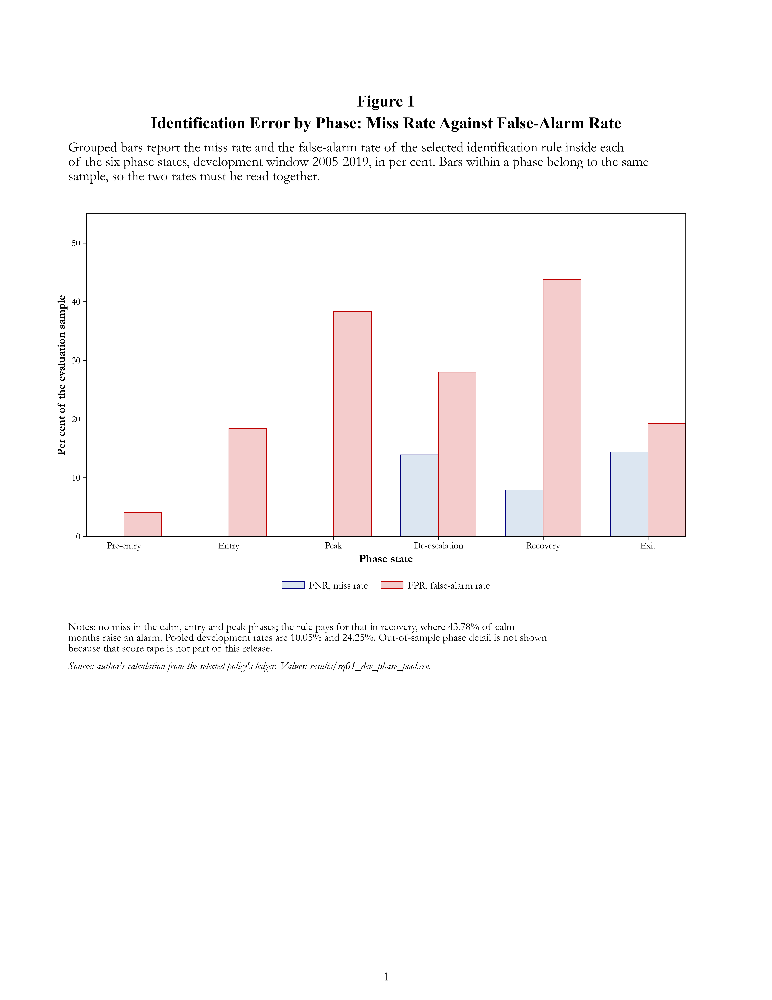
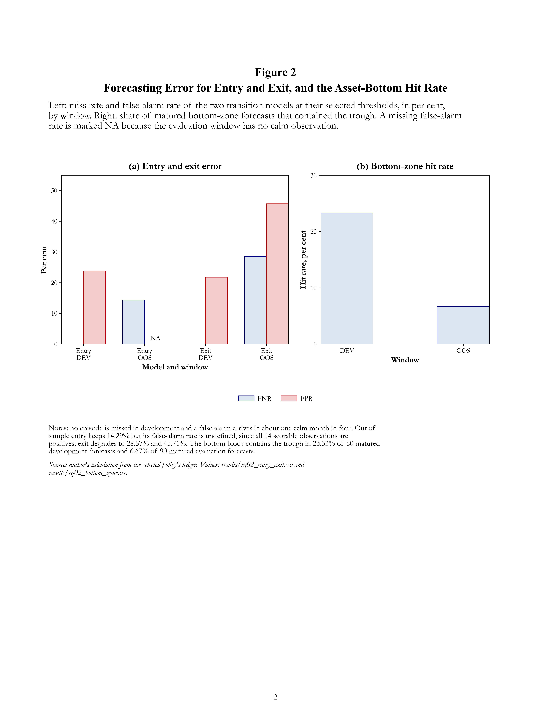
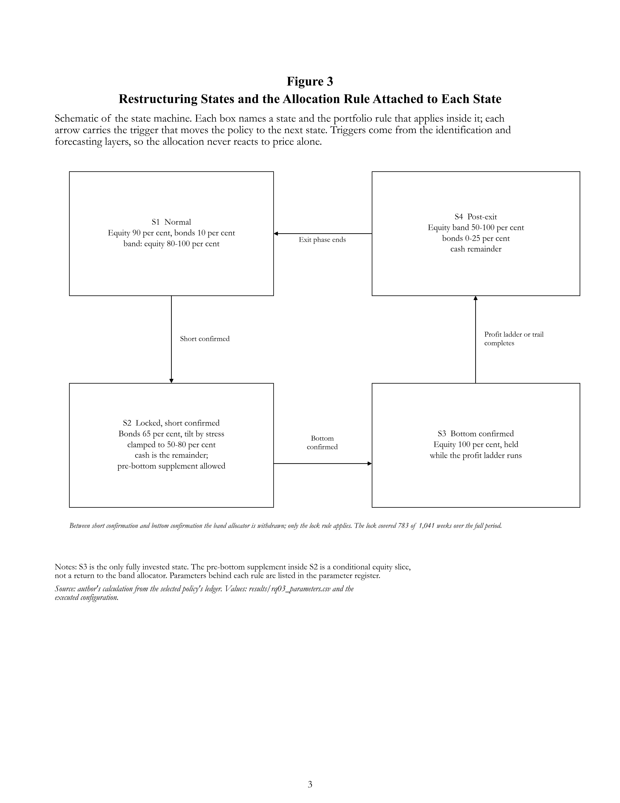
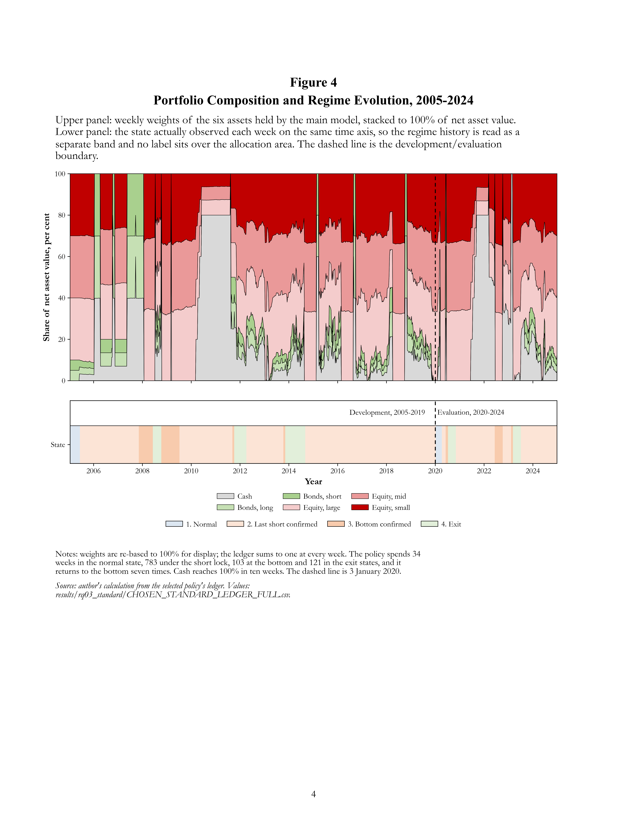
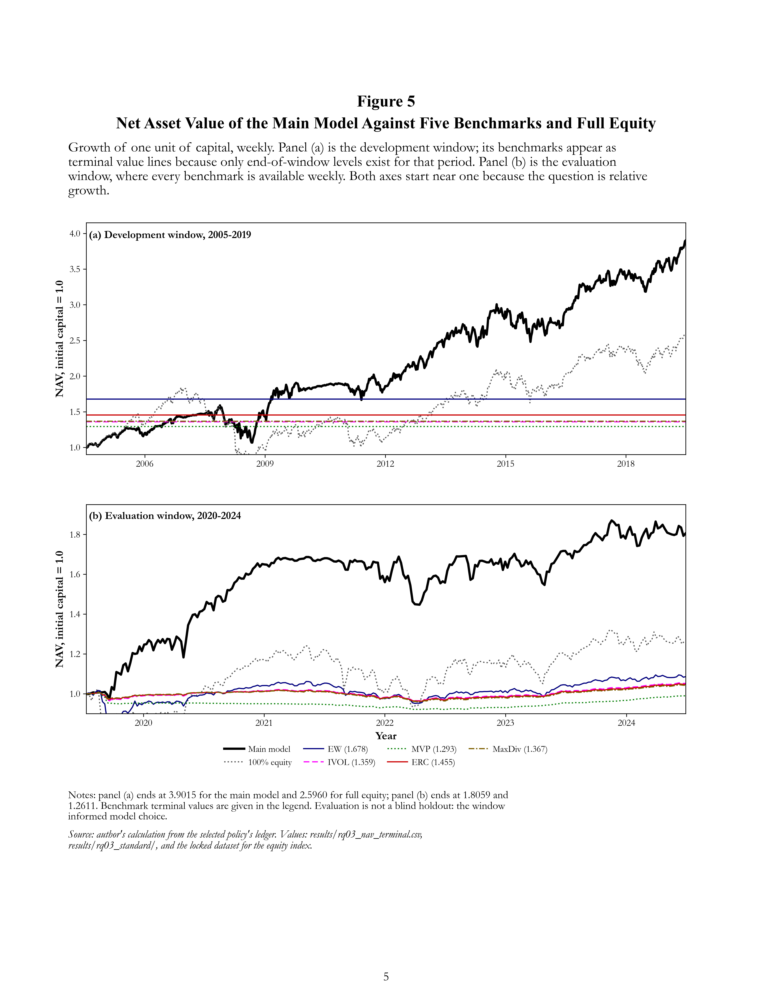
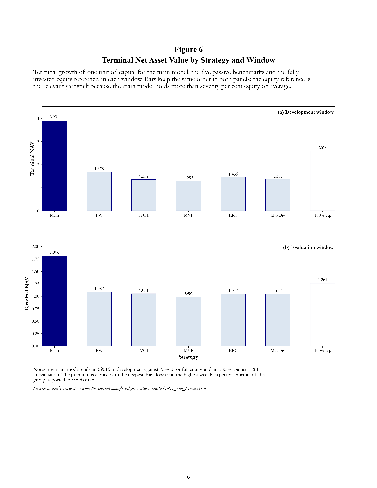

# Financial stress identification, transition forecasting and state-dependent portfolio allocation

**A three-stage decision chain for seven euro-area countries — evidence from a development and an out-of-sample window**

---

## 1. Project overview

This repository studies whether a financial-stability signal can be turned into a usable investment decision. The
chain has three links, each evaluated separately so that a failure in one does not hide behind success in another:

1. **Stress identification (RQ01).** Is the economy currently in a financially stressful state, and what is the source
   of the stress — domestic, global, or both? The output is a binary stress decision, updated monthly, for Belgium,
   Germany, Spain, Finland, France, Italy and the Netherlands.
2. **Transition forecasting (RQ02).** Will stress *start*, will it *end*, and when does the equity market reach its
   bottom? Three separate models are estimated: an entry model, an exit model and a bottom-zone model.
3. **Portfolio allocation (RQ03).** Given the state and the transition signals, how should a six-asset portfolio be
   restructured, and does the restructuring add value against five passive benchmarks and against a fully invested
   equity portfolio?

**Data.** Monthly financial-condition indicators (CISS, CLIFS, DFC, GFC, VIX, credit growth and the debt-service
ratio) for the seven countries, weekly total-return indices for three equity and two bond groups plus a cash proxy, and
the European Systemic Risk Board stress labels used only as an evaluation benchmark, never as an input.

**Periods.** The development window is July 2005 to December 2019 and contains 1,218 country-months, 800 of them
calm. The evaluation window is January 2020 to December 2024. ESRB labels stop in April 2021, so only 112 of the 420
out-of-sample country-months can be scored against a label; the remainder are used for prediction only and are never
counted as calm.

**How the links connect.** RQ01 produces the state; RQ02 produces the timing signals (last short, bottom, exit); RQ03
consumes both and decides the weights. The three research questions therefore share one data pipeline but are scored
with different metrics, because identifying a state, forecasting an event and earning a return are different tasks.

**Headline result.** Identification works in the development window (miss rate 10.05%, false-alarm rate
24.25%) but degrades out of sample (15.38% and 23.81%). Forecasting is the weakest link: entry
is reliable in development, exit and bottom are not. The portfolio built on these signals ends the development window at
3.9015 times the initial capital against 1.6784 for equal weights, 1.2934–1.4548
for the optimised benchmarks and 2.5960 for a fully invested equity portfolio, and compounds to 5.6981
over the continuous 2005–2024 path. The gain is paid for with the highest tail risk in the comparison group.

**Important disclosure.** The out-of-sample window was *not* a blind holdout. The country thresholds in RQ01 and the
portfolio overlay in RQ03 were selected after that window had been opened during the research programme. The
out-of-sample figures are therefore an honest description of behaviour in 2020–2024, not independent confirmation.

---

## 2. RQ01 — Financial stress identification

### 2.1 How a decision is built

Three layers produce one binary decision. They are not equally weighted, and the code does not average them.

**Individual.** Each indicator votes on its own history. For every source the model measures the standardised level, the
change over three and twelve months, and the drawdown from the running peak, then compares those quantities with
source-specific quantiles estimated on the development window only. A source votes *up* when the movement exceeds its
upper quantile, *down* when it falls below the lower quantile, and *sideways* otherwise; it is flagged *strong* when the
standardised level passes the strong quantile. No cross-source information enters this layer.

**Joint.** Two sources form a pair only when their observations are synchronised in the same month and their joint
movement matches a motif — for example both moving down together, or one down and one sideways. The pair also carries
the individual thresholds of both members and the applicable publication lag, so a pair can only fire when both members
are already available at the decision date. Ten pairs are evaluated; a motif is retained per pair.

**Pool.** The pool integrates what is available: an Individual signal, a Joint signal, or both. The rule verified in the
code is not an average but a sequence of set operations on a pooled score. For a country at month *t*:

> stress  =  ( pooled stress probability ≥ country threshold )  OR  ( the slow-volatility joint pair fires )
>            AND NOT ( the domestic-versus-global divergence pair fires )

The score is a boosted-tree probability of stress; the country threshold is the only country-specific parameter. Both
pairs are binary packet flags produced by the Joint layer.

### 2.2 Selected thresholds

| Country | Selected threshold |
|---|---|
| BE | 0.014142 |
| DE | 0.013772 |
| ES | 0.036130 |
| FI | 0.012599 |
| FR | 0.006048 |
| IT | 0.017520 |
| NL | 0.985170 |

The thresholds span two orders of magnitude because the score itself is not comparable across countries: a country that
is almost always stressed needs a threshold close to one to separate its calm months, and a country with few stressed
months needs a very low one. Using a single common threshold would either silence the low-stress countries or turn the
high-stress ones permanently on.

**Figure 1. Identification Error by Phase: Miss Rate Against False-Alarm Rate**



**Interpretation.** The rule is silent in the calm, entry and peak phases and pays for that silence in recovery, where 43.78% of calm months raise an alarm. Read the phases rather than the pooled line: the pooled 10.05% and 24.25% average a rule that is either perfectly quiet or strongly over-sensitive.

**Limitation.** The phase split is a development-window diagnostic; the out-of-sample score tape needed to repeat it is not part of this release, so the panel is not a validation result.


### 2.3 Development window (2005–2019)

| period | TP | FN | FP | TN | FNR | FPR |
|---|---|---|---|---|---|---|
| DEV | 376 | 42 | 194 | 606 | 10.05 | 24.25 |
| OOS | 77 | 14 | 5 | 16 | 15.38 | 23.81 |


**Key finding.** The pooled decision misclassifies one stressed month in ten and one calm month in four. Numerically 42
of 418 stressed months are missed and 194 of 800 calm months raise a false alarm.

**Economic interpretation.** A miss rate near 10% with a false-alarm rate near 25% is the profile of a monitoring tool,
not of an automated switch: it is right often enough to be informative and wrong often enough that a user must combine it
with judgement.

**Comparison.** The layered structure is not decorative. Removing the joint layer and keeping only the country
threshold gives a lower miss rate but a much higher false-alarm rate; removing the exclusion pair does the opposite:

| variant | TP | FN | FP | TN | FNR | FPR | alarms |
|---|---|---|---|---|---|---|---|
| Individual only (per-country threshold on the pooled score) | 394 | 24 | 120 | 680 | 5.74 | 15.00 | 514 |
| Individual + Joint (pair OR) | 397 | 21 | 200 | 600 | 5.02 | 25.00 | 597 |
| Pool (pair OR, excluded by the negative pair) | 376 | 42 | 194 | 606 | 10.05 | 24.25 | 570 |


The joint layer buys 0.72 percentage points of miss rate for 10.00 points of extra
false alarms, so it is close to a pure trade rather than a free improvement. The exclusion pair is what actually changes
the character of the rule: it removes 27 alarms and costs 5.03 points of
miss rate. Reading the rule as "threshold plus two filters" is therefore more accurate than reading it as a vote.

**By phase.** | phase_label | n | TP | FN | FP | TN | FNR | FPR |
|---|---|---|---|---|---|---|---|
| Pre-entry | 148 | 1 | 0 | 6 | 141 | 0.00 | 4.08 |
| Entry | 44 | 6 | 0 | 7 | 31 | 0.00 | 18.42 |
| Peak | 62 | 15 | 0 | 18 | 29 | 0.00 | 38.30 |
| De-escalation | 86 | 31 | 5 | 14 | 36 | 13.89 | 28.00 |
| Recovery | 429 | 210 | 18 | 88 | 113 | 7.89 | 43.78 |
| Exit | 449 | 113 | 19 | 61 | 256 | 14.39 | 19.24 |
| All phases | 1218 | 376 | 42 | 194 | 606 | 10.05 | 24.25 |

The rule is conservative while the economy is calm or entering stress (no misses in the pre-entry, entry and peak
phases) and pays for that in recovery, where four calm months in ten raise an alarm. In the exit phase the balance
reverses: the miss rate rises to 14.39% while false alarms fall. A user who cares about not missing stress should read
the recovery-phase false alarms as the price of that preference.

**Limitation.** The phase comparison uses the development window only, and the phases are produced by the same RQ01
machinery that the rule is scored against; the phase split is descriptive, not an independent test.

### 2.4 Out-of-sample window (2020–2024)

| period | TP | FN | FP | TN | FNR | FPR |
|---|---|---|---|---|---|---|
| DEV | 376 | 42 | 194 | 606 | 10.05 | 24.25 |
| OOS | 77 | 14 | 5 | 16 | 15.38 | 23.81 |


**Key finding.** Out of sample the rule keeps its false-alarm rate (23.81% against 24.25%) but its miss
rate rises from 10.05% to 15.38%.

**Interpretation.** The stability of the false-alarm rate with a rising miss rate means the rule did not become noisier;
it became less sensitive. During a window in which stress was rare in the labelled part, that is the expected failure
mode of a threshold selected in a calmer sample.

**Limitation.** Only 112 of the 420 out-of-sample country-months carry a label. The scored subsample is small,
the per-phase split cannot be reproduced because the out-of-sample score tape is not part of this repository, and the
window informed the threshold choice, so the numbers describe rather than confirm.

---

## 3. RQ02 — Transition forecasting

### 3.1 What is forecast

Three questions, three models:

* **Entry** — will a stress episode start within a fixed horizon? The horizon ladder runs from 45 months (H15) down to
  18 months (H6); the published operating point uses the shortest, 18 months, because it produced the best balance
  between missed onsets and false alarms in development.
* **Exit** — will the episode end within three months? A duration term is added to the same signal set, because the
  probability of exit rises with the age of the episode.
* **Bottom** — is the equity market at or near a trough? This is not a probability model but a zone rule: three
  independent factors must vote.

### 3.2 Individual, Joint and Pool in the transition models

The transition models reuse the RQ01 vocabulary but assemble it differently. **Individual** contributions are the
source-level movements and their accumulation over the horizon window. **Joint** contributions are the synchronised pair
confirmations, which are only admissible when both members are published before the issue date, so a pair cannot leak
future information into the forecast. **Pool** is the combination actually used for the decision: the individual and
joint confirmations are pooled into a single score, and that score is compared with the selected threshold.

Two signal systems feed the pool. The **Long** system accumulates slow-moving confirmations from 45 months down to the
horizon: it answers whether stress is building. The **Short** system is a five-vote mechanism whose final vote is a
*last short* flag: it answers whether the episode is about to turn. The Long system drives the entry model; the Short
system drives the exit and bottom models. Combining the two is what allows the same dataset to produce both a "stress is
coming" signal and a "the turn is near" signal without confusing them.

### 3.3 Development window

| task | period | threshold | n | TP | FN | FP | TN | FNR | FPR |
|---|---|---|---|---|---|---|---|---|---|
| ENTRY (18 months, logistic L2) | DEV | 0.111821 | 653 | 108 | 0 | 130.00 | 415.00 | 0.00 | 23.85 |
| ENTRY (18 months, logistic L2) | OOS | 0.111821 | 14 | 12 | 2 | — | — | 14.29 | — |
| EXIT (3 months) | DEV | 0.027174 | 418 | 18 | 0 | 87.00 | 313.00 | 0.00 | 21.75 |
| EXIT (3 months) | OOS | 0.027174 | 91 | 15 | 6 | 32.00 | 38.00 | 28.57 | 45.71 |


**Key finding.** Entry and exit are both perfect on the miss dimension in development — no episode is missed at the
selected threshold — and both accept a substantial false-alarm rate to achieve it (23.85% for entry and
21.75% for exit).

**Interpretation.** The models are calibrated towards recall. That is defensible for a risk-monitoring use — a missed
onset is more expensive than a false alarm — but it means the point estimate should never be presented as "the model
predicts stress": it predicts stress often.

**Bottom.** 14 of 60 matured forecasts hit the trough zone, a hit rate of 23.33%, with a median lead time that is negative — the model on average fires after the trough.
A negative lead time is the defining weakness: the zone is often identified, but too late to be acted on.
Coverage is 70.59% of the eligible months, so the rule also abstains.

**Limitation.** The bottom results are asset-level and depend on the choice of the truth window; they are not a
portfolio-level test.

### 3.4 Out-of-sample window

| task | period | threshold | n | TP | FN | FP | TN | FNR | FPR |
|---|---|---|---|---|---|---|---|---|---|
| ENTRY (18 months, logistic L2) | DEV | 0.111821 | 653 | 108 | 0 | 130.00 | 415.00 | 0.00 | 23.85 |
| ENTRY (18 months, logistic L2) | OOS | 0.111821 | 14 | 12 | 2 | — | — | 14.29 | — |
| EXIT (3 months) | DEV | 0.027174 | 418 | 18 | 0 | 87.00 | 313.00 | 0.00 | 21.75 |
| EXIT (3 months) | OOS | 0.027174 | 91 | 15 | 6 | 32.00 | 38.00 | 28.57 | 45.71 |


**Key finding.** Entry keeps a low miss rate (14.29%) but its false-alarm rate cannot be defined: all
14 scorable observations are positives, so there are no calm observations against which to count a false
alarm. Exit degrades on both dimensions, to 28.57% and 45.71%.

**What is unavailable, and why.** The empty false-alarm rate is a statement about the sample, not a zero. Reporting it
as 0.00% would make the exit model look perfect. The same applies to the bottom block:

| period | n_hit | n_issued_matured | hit_rate | forecast_coverage |
|---|---|---|---|---|
| DEV | 14 | 60 | 23.33 | 70.59 |
| OOS | 6 | 90 | 6.67 | 94.74 |


The out-of-sample bottom block is scored in the registered table: 6 of 90
matured forecasts contained the trough (6.67%), against 14 of
60 (23.33%) in development. In addition, the operating point published here
(threshold 0.111821) cannot be re-derived from the tapes shipped in this repository; the closest
reproducible operating points are:

| variant | DEV_FNR | DEV_FPR | OOS_FNR | OOS_FPR | status |
|---|---|---|---|---|---|
| Selected operating point 0.111821 | 0.00 | 23.85 | 14.29 | — | SELECTED — tape not shipped |
| reproducible reproducible logistic score at 0.191936 | 0.00 | 12.48 | 35.71 | — | REPRODUCIBLE from shipped registry |
| reproducible reproducible logistic score at 0.244947 | 0.00 | 3.67 | 42.86 | — | REPRODUCIBLE from shipped registry |


**Figure 2. Forecasting Error for Entry and Exit, and the Asset-Bottom Hit Rate**



**Interpretation.** Entry buys its low miss rate with false alarms in development and cannot be scored on false alarms out of sample, where all 14 observations are positives. Exit is the opposite: quiet in development, then 28.57% and 45.71% in evaluation. The bottom zone is weakest, keeping the trough inside the zone in about one forecast in four in development and one in fifteen in evaluation.

**Limitation.** Two of the five rates are undefined rather than zero, and the evaluation block rests on 14, 91 and 90 scorable observations, so none of these rates is estimated with precision.


**Interpretation.** The gap between development and out-of-sample accuracy is the central result of RQ02. Entry
survives because onset has a slow, persistent signature. Exit and bottom do not, because both depend on the exact timing
of a turning point, and the out-of-sample window contains a single shock whose timing cannot be learned from one earlier
episode.

**Limitation.** Fourteen scorable observations cannot support a rate. The forecast should be read as directional
evidence, and any use in a decision rule has to be robust to the timing error shown above.

---

## 4. RQ03 — State-dependent portfolio allocation

### 4.1 Universe and benchmarks

Six assets, rebalanced weekly with a 10 basis point one-way transaction cost: three equity total-return indices (large,
mid and small cap) and two bond groups (short and long maturity) plus a cash proxy. The Main Model allocates between
these six. Five independent benchmarks are constructed from the same universe with documented passive rules and are
*not* subject to the Main Model's state machine or its lock:

| Benchmark | Construction | Why it is in the comparison |
|---|---|---|
| EW | equal weight across the six assets | the naive portfolio; hard to beat after costs |
| IVOL | weights inversely proportional to each asset's realised volatility | the simplest risk-scaling rule |
| MVP | minimum-variance weights | the most defensive of the five |
| ERC | equal risk contribution | risk parity without a return forecast |
| MaxDiv | maximum diversification | the most equity-seeking of the five |

A sixth reference, **100% equity**, holds the three equity indices equal-weighted with no bonds and no cash. It is the
honest yardstick for a strategy whose average equity share is above 70%.

### 4.2 The restructuring mechanism

The Main Model is not a static weighting rule with a filter on top. It is a four-state machine in which the *permission*
to restructure changes with the state. The diagram below is the complete transition structure.

**Figure 3. Restructuring States and the Allocation Rule Attached to Each State**



**Interpretation.** The diagram locates the lock precisely: between short confirmation and bottom confirmation the band allocator is withdrawn and only the lock rule applies, which is why the policy spends most of its life in a defensive posture and still holds equity when the bottom is confirmed.

**Limitation.** The boxes state the rules as executed; they do not carry parameter values, which are listed in the register below.


The four states are labelled **S1** (normal), **S2** (locked after short confirmation), **S3** (bottom confirmed) and
**S4** (post-exit). These labels are used in the diagram and in the parameter register below.

**1. State identification.** The state is read from two inputs: the RQ01 regime (normal versus stress) and the RQ02
phase clock. Normal means the RQ01 decision is calm; stress means it is not. The phase clock is what distinguishes
"stress building" from "stress already paid for", and it is the clock — not the regime — that controls the lock.

**2. Common restructuring under normal and stress.** In the normal state the model runs an ordinary band allocator.
Equity is centred at 90% and moves inside an 80–100% band as a function of the volatility z-score and the stress
probability; bonds take 0–20% and cash the residual. In the stress state, outside a confirmed bottom, the same allocator
concentrates on bonds: 50–80% bonds, the remainder in cash, no equity. This is the "common" mechanism: it is always
available, and it is the mechanism the model returns to.

**3. Short confirmation changes eligibility.** When the RQ02 short system confirms that the episode is in its final
phase, the model enters the locked state. Eligibility changes in a specific sense: the ordinary band allocator is
*withdrawn*. From that week the portfolio is not re-optimised on new information; a single lock rule sets the target.

**4. Why the lock exists.** Between short confirmation and bottom confirmation the model holds 65% ± 10% of NAV in
bonds, with the tilt driven by the stress probability and the result clamped to 50–80%, and holds cash for the rest. The
lock is a deliberate refusal to trade: it prevents the strategy from selling equity into the final decline and then
buying it back higher, and it prevents it from buying before the decline is over. The cost is visible in the data — the
locked state occupies 596 of 781 development weeks — and so is the benefit, since the average equity share inside the
lock is 70.4% rather than zero.

**5. Bottom confirmation activates the bottom mechanism.** When the bottom triggers are simultaneously satisfied — normal
probability at least 0.995, stress probability at most 0.02, volatility z-score at least 2.0 and distance to the running
peak at most 5% — the bottom state is confirmed and a different mechanism takes over: equity is set to 100% of NAV and
held. This is the only place in the policy where the model is fully invested.

**6. How weights are calculated and adjusted.** Every target is built from a *source* portfolio and an equity/bond pair.
The equity sleeve is distributed across the three equity indices in the proportions the previous portfolio already held,
so the model does not take a new cross-sectional bet when it changes its total equity exposure; the bond sleeve is split
equally between the two bond groups; cash takes the remainder. Inside the normal and post-exit states the equity share
comes from the band interpolation, tilted by the stress probability.

**7. What limits the weights.** Four constraints act on every target. The hard expected-shortfall cap (2% weekly) shrinks
the target until the historical weekly expected shortfall is below the cap. The band clamps bound each state. The cash
residual is floored at zero, so leverage is impossible. And the transaction-cost model charges 10 basis points on the
realised turnover, which is what makes a small adjustment uneconomic and produces the low average turnover of 7.8% per
week in development.

**8. Returning to the ordinary mechanism.** After the bottom position, the profit ladder takes over: four trims of 20%
each at +8%, +16%, +25% and +40% of the entry gain, with a four-week cooldown between trims, a minimum holding period of
52 weeks and a trailing stop of 10% on the residual (15% on the runner kept after the second trim). When the ladder or
the stop completes, the model passes through a post-exit state in which the band allocator is restored with a lower
equity floor, and returns to the normal state once the phase clock leaves the exit phase. Twenty-six consecutive normal
weeks re-arm the bottom supplement for a new cycle.

**Figure 4. Portfolio Composition and Regime Evolution, 2005-2024**



**Interpretation.** The policy is equity-heavy by design: the three equity sleeves hold roughly three quarters of NAV for most of the period, cash reaches 100% in ten weeks only, and the regime band shows a cycle rather than a one-way de-risking. The lock is where most of the sample is spent, 783 of 1,041 weeks, so the mechanism is better described as a long defensive wait interrupted by short bottom states.

**Limitation.** Weekly weights are re-based to 100% for display and the band records the states the executed configuration produced; a different execution path would move the band even under identical rules.


### 4.3 Parameter register

Every value below is read from the configuration the executed policy used. "Fixed assumption" means a design choice
that was not fitted; "calibrated" means a value chosen on the development window; "calculated" means a derived quantity.

| Parameter / Threshold | Actual Value | Unit | Activation Condition | Effect on Portfolio | Class |
|---|---|---|---|---|---|
| Allocation engine | four-state state-and-cycle allocator | — | always | State-and-cycle allocator: four states, each with its own weight rule | Fixed assumption |
| Normal-state equity target | 0.9 | share of NAV | state S1 (no lock, no bottom) | Sets the core equity weight; the rest of S1 is bonds | Calibrated |
| Normal-state bond target | 0.1 | share of NAV | state S1 | Bond sleeve B1/B2 split equally; cash is the residual | Calibrated |
| Lock-state bond share (base) | 0.65 | share of NAV | state S2 (short confirmed, bottom not yet confirmed) | Bond share of the locked portfolio at neutral probabilities | Calibrated |
| Lock-state stress tilt | 0.1 | share per unit of P_S | state S2 | Raises the bond share as the stress probability rises, inside a 50–80% band | Calibrated |
| Pre-bottom residual split | pro-rata | rule | state S2 when the pre-bottom supplement is active | Residual after equity is split pro-rata between bonds and cash (65% to bonds) | Fixed assumption |
| Pre-bottom window | 26 | weeks | state S2 supplement active | Caps how long the early-equity supplement may stay on | Calibrated |
| Pre-bottom cooldown | 4 | weeks | after a pre-bottom exit | Blocks immediate re-entry into the supplement | Calibrated |
| Pre-bottom stop | 0.1 | return | supplement active | Cuts the supplement when its own equity basket falls by this much | Calibrated |
| Bottom confirmation: normal probability | 0.995 | probability | state S2 | One of the four gates that must all hold before bottom equity is deployed | Calibrated |
| Bottom confirmation: stress probability | 0.02 | probability | state S2 | Stress must have collapsed to this level | Calibrated |
| Bottom confirmation: volatility z-score | 2 | standard deviations | state S2 | Deep-drawdown regime required before full equity is bought | Calibrated |
| Bottom confirmation: drawdown tolerance | 0.05 | return | state S2 | Maximum remaining distance to the running peak accepted at confirmation | Calibrated |
| Bottom-state equity target | 1 | share of NAV | state S3 (bottom confirmed) | Moves the portfolio to a fully invested equity position | Calibrated |
| Recovery equity cap | 0.8 | share of NAV | post-bottom recovery path | Intermediate equity level when the cycle has not been reset | Calibrated |
| Recovery normal-probability gate | 0.98 | probability | recovery path | Normal probability required to leave the recovery allocation | Calibrated |
| Recovery stress-probability gate | 0.02 | probability | recovery path | Stress probability required to leave the recovery allocation | Calibrated |
| State S4 high-volatility response | bonds absorb the shock | rule | state S4 with elevated z | S4 absorbs the shock through bonds rather than cash | Fixed assumption |
| Post-exit equity floor | 0.5 | share of NAV | states S4 | Lowest equity weight the band can produce after a completed cycle | Calibrated |
| Post-exit bond ceiling | 0.25 | share of NAV | states S4 | Upper bound of the bond band in the post-exit state | Calibrated |
| Volatility-z direction | risk-off | sign | states S1 and S4 | Risk-off mapping: a higher volatility z-score lowers equity; no contrarian inversion is used | Fixed assumption |
| Profit-taking ladder | +8% / 20%; +16% / 20%; +25% / 20%; +40% / 20% | gain / share | bottom position held | Four trim steps of 20% each at +8%, +16%, +25% and +40% | Calibrated |
| Tranche cooldown | 4 | weeks | between two trims | Prevents trimming twice in consecutive weeks | Calibrated |
| Minimum holding after the bottom | 52 | weeks | bottom position held | Keeps the bottom exposure for a full year before the ladder completes | Calibrated |
| Profit trail | 0.1 | drawdown from peak | after the ladder | Closes the residual position when it retraces this far | Calibrated |
| Runner activation | 2 | tranches completed | after the ladder | Number of completed trims after which a runner is kept | Calibrated |
| Runner trail | 0.15 | drawdown from peak | runner active | Wider trail applied only to the runner | Calibrated |
| Profit proceeds destination | on | rule | on every trim | Proceeds go to cash, not to bonds | Fixed assumption |
| Post-bottom equity cap | 1 | share of NAV | states S3/S4 | Hard ceiling on equity once the bottom has been confirmed | Calibrated |
| Post-bottom stop | 0.1 | return | states S3/S4 | Stops the position if it falls this far from entry | Calibrated |
| Pre-bottom stop | 0.08 | return | states S1/S2 | General stop applied to the equity sleeve before the bottom | Calibrated |
| Stop reference | equal-weight equity basket | rule | whenever a stop applies | Stop is measured on the equal-weight equity basket, not on NAV | Fixed assumption |
| Hard expected-shortfall cap | 0.02 | weekly return | every rebalance | Shrinks the target until the historical weekly ES is below the cap | Calibrated |
| Pre-bottom ES overlay | — | rule | supplement active | NONE: the pre-bottom supplement is not additionally ES-constrained | Fixed assumption |
| Bottom supplement switch | on | flag | states S2/S4 | Enables the bottom-specific supplement that allows equity before confirmation | Calibrated |
| Forced bottom entry | off | flag | state S2 | Disabled; the bottom is only traded on confirmation | Fixed assumption |
| Cycle reset window | 26 | weeks | after a completed cycle | Consecutive normal-state weeks required to re-arm the bottom supplement | Calibrated |
| Cycle reset normal-probability | 1.01 | probability | after a completed cycle | Set above 1, so the probability branch never triggers and the reset is inert | Fixed assumption |
| Risk-tolerance scaling | off | flag | every rebalance | Disabled: the alpha/ES tolerance table is not applied to size | Fixed assumption |
| Bottom trigger rule | first confirmed bottom | rule | state S3 | ANY: the first confirmed bottom starts the bottom state | Fixed assumption |
| Bottom lookback | 0 | weeks | state S3 | Zero: the tail trigger uses the whole available history | Fixed assumption |
| Bottom ES bypass | on | flag | state S3 | The hard ES cap is not applied inside the bottom state | Fixed assumption |
| Lock-state bond band | 50 – 80 | share of NAV | state S2 | Bond share is clamped to 50–80%; the complement is cash | Calculated |
| Transaction cost | 10 | basis points | on every traded notional | One-way cost charged on realised turnover | Fixed assumption |


Two parameters deserve explicit disclosure because they are often assumed to be active. The risk-tolerance scaling table
is **disabled** (`off`), so position size is not rescaled by an investor risk-aversion parameter. The cycle-reset
probability branch is **inert** by construction — its normal-probability threshold is set above 1 — so the cycle is
re-armed by time (26 normal weeks) and not by a probability condition.

### 4.4 Development window (2005–2019)

| period | weeks | POLICY | EW | IVOL | MVP | ERC | MaxDiv | EQUITY100 |
|---|---|---|---|---|---|---|---|---|
| DEV | 781 | 3.9015 | 1.6784 | 1.3592 | 1.2934 | 1.4548 | 1.3675 | 2.5960 |
| OOS | 260 | 1.8059 | 1.0867 | 1.0515 | 0.9892 | 1.0466 | 1.0417 | 1.2611 |


**Key finding.** The Main Model ends the development window at 3.9015, against 1.6784 for equal weights
and 1.4548 for the best optimised benchmark; the fully invested equity portfolio reaches 2.5960.

**Interpretation.** The model beats every passive construction, but not the naive equity benchmark: a portfolio that
simply holds the three equity indices and nothing else earns 2.5960. The excess over equity comes from the
bond and cash sleeve during drawdowns, not from a better equity selection.

**Risk, side by side.** Maximum drawdown and weekly expected shortfall for the same six strategies:

| strategy | MDD_DEV | MDD_OOS | ES95_DEV | ES95_OOS |
|---|---|---|---|---|
| Main model | 0.3283 | 0.1430 | 0.0452 | 0.0395 |
| EW | 0.1943 | 0.1573 | 0.0198 | 0.0268 |
| IVOL | 0.0498 | 0.0737 | 0.0067 | 0.0091 |
| MVP | 0.0337 | 0.0819 | 0.0045 | 0.0061 |
| ERC | 0.0375 | 0.0597 | 0.0066 | 0.0068 |
| MaxDiv | 0.0342 | 0.0748 | 0.0052 | 0.0072 |

The Main Model carries the deepest drawdown of the group in development (32.84% against 19.43% for equal weights
and 3.4–5.0% for the optimised benchmarks) and the highest weekly expected shortfall in both windows (4.52% and 3.95%).
That is the price of the return premium, and it is paid continuously rather than in a single episode.

**Where the return is made.** | period | avg_equity_pct | avg_bond_pct | avg_turnover_pct | total_cost_pct_nav |
|---|---|---|---|---|
| DEV | 72.60 | 10.94 | 7.80 | 4.09 |
| OOS | 72.24 | 5.27 | 9.76 | 1.54 |

The strategy carries an average equity share of 72.6% and pays
4.09% of NAV in costs over fifteen years.

**By stage.**
| Stage | weeks | avg_equity_pct | avg_bond_pct | avg_turnover_pct | total_cost_pct_nav |
|---|---|---|---|---|---|
| Normal, before short confirmation | 21 | 90.00 | 9.84 | 10.18 | 0.11 |
| Bottom confirmed, profit ladder running | 77 | 79.85 | 10.81 | 12.17 | 0.59 |
| Exit from the bottom position | 14 | 78.67 | 9.95 | 3.80 | 0.03 |
| Locked, short confirmed, bottom pending | 596 | 70.38 | 11.12 | 6.61 | 2.78 |
| Post-exit, band allocator restored | 73 | 76.91 | 10.13 | 13.07 | 0.58 |


**Limitation.** The development window contains the 2008 and 2011 episodes, which is exactly the environment the policy
was designed for; a fifteen-year window with two large drawdowns is a favourable sample for a defensive overlay.

### 4.5 Out-of-sample window (2020–2024)

| period | weeks | POLICY | EW | IVOL | MVP | ERC | MaxDiv | EQUITY100 |
|---|---|---|---|---|---|---|---|---|
| DEV | 781 | 3.9015 | 1.6784 | 1.3592 | 1.2934 | 1.4548 | 1.3675 | 2.5960 |
| OOS | 260 | 1.8059 | 1.0867 | 1.0515 | 0.9892 | 1.0466 | 1.0417 | 1.2611 |


**Figure 5. Net Asset Value of the Main Model Against Five Benchmarks and Full Equity**



**Interpretation.** The main model compounds 3.9015 in development and 1.8059 in evaluation, against 2.5960 and 1.2611 for full equity and 1.678/1.087 for equal weights. The gap opens in the two drawdowns, where the policy keeps equity and the benchmarks do not, and it is not given back in the recoveries.

**Limitation.** Development benchmarks are drawn as terminal values because only end-of-window levels exist for that period; the evaluation window was open when the model was chosen, so panel (b) is not a blind holdout.


**Key finding.** Out of sample the Main Model earns 1.8059 against 1.0867 for equal weights,
1.0515 for the best optimised benchmark and 1.2611 for 100% equity.
It beats all five benchmarks and also beats the fully invested equity portfolio.

**Are higher returns accompanied by higher risk?** Yes, and the comparison is unambiguous. The maximum drawdown is
32.84% in development and 14.30% out of sample, against 19.43% and 15.73% for equal weights and 3.4–5.0% and 6.0–8.2%
for the optimised benchmarks; the weekly expected shortfall of 4.52% and 3.95% is the highest of the six strategies in
both windows. The return premium is earned by carrying a permanently high equity share, not by de-risking at the right
time.

**Interpretation.** The model is a return engine with a defensive overlay, not a risk-control device. An investor whose
objective is to minimise drawdown would reject it; an investor whose objective is terminal wealth subject to an
acceptance of large interim losses would not.

**Figure 6. Terminal Net Asset Value by Strategy and Window**



**Interpretation.** Terminal NAV ranks the main model first in both windows, with full equity second in both and the five passive rules left near one. The ordering does not flip between windows, which is the relevant test for a rule applied unchanged.

**Limitation.** Terminal NAV ignores the path: the strategy reaches these levels with the deepest drawdown and the highest weekly expected shortfall of the group, so the ranking is not a risk-adjusted one.


**Limitation.** The out-of-sample window is 260 weeks and contains one shock. The strategy was selected with that
window already open, so the comparison against the benchmarks is not an independent test. Turnover and cost are charged
but execution is simulated at a fixed 10 basis points with no market impact, no borrow cost and no liquidity limit.

---

## 5. Conclusions

1. **Identification is the reliable link.** A layered rule — country threshold, joint confirmation, one exclusion pair —
   reaches a 10% miss rate at a 25% false-alarm rate in development, and keeps the false-alarm rate out of sample while
   losing sensitivity.
2. **Forecasting is the weak link.** Entry survives out of sample on the miss dimension but cannot be scored on false
   alarms; exit and bottom both degrade, and the bottom forecast fires late. Missing labels are reported as missing, not
   as calm.
3. **Allocation adds value on return and costs value on risk.** The Main Model beats five passive benchmarks and a fully
   invested equity portfolio in both windows, with the highest drawdown and the highest expected shortfall of the group.
4. **The lock is the distinctive design choice.** Refusing to restructure between short confirmation and bottom
   confirmation is what distinguishes this policy from a band rebalancer; it is also why the portfolio spends most of its
   life in a defensive posture and still captures the recovery.
5. **What the evidence does not support.** It does not support independent out-of-sample validation, deployment without
   an owner-approved risk budget, or use of the bottom forecast as a timing signal.

---

## 6. Reproducibility

```bash
pip install -r requirements.txt

# RQ01 and RQ02 artefacts, including the 34-output report
python RAW_CODE/run_canonical.py --dataset-root <ASSET03> --out <out> --mode dev
python RAW_CODE/run_canonical.py --dataset-root <ASSET03> --out <out> --mode oos \
    --oos-authorization <owner token>

# RQ03 standard (requires the project's research hand-off tree)
RQ_PROJECT_ROOT=<project> RQ_OUT=results/rq03_standard \
    python RAW_CODE/rq03_standard/build_chosen_standard.py

# Tables and figures behind this document
python scripts/build_final_results.py --project <project> --repo . \
    --ledger-dir results/rq03_standard --dataset <ASSET03>
python scripts/build_presentation_assets.py --params <params.json> \
    --ledger-dir results/rq03_standard --out results
```

`THRESHOLD/` holds every selected value: the seven country thresholds, the entry and exit operating points and the
portfolio standard. No threshold is inferred at run time and no dataset is redistributed with the repository.

## 7. Data, limitations and status

* **Status.** Research output, not an investment product. No statement here is a recommendation.
* **Labels.** ESRB stress labels are an evaluation benchmark only; where a label is missing the observation is excluded
  from scoring and never treated as calm.
* **Costs and execution.** Fixed 10 basis points one-way, no market impact, no borrow cost, no liquidity constraint.
* **Scope.** Seven euro-area countries. The eighth country could not be added because of a data-contract conflict, so the
  results do not generalise beyond this group.
* **Selection.** The out-of-sample window informed model choice; treat the 2020–2024 results as descriptive.
